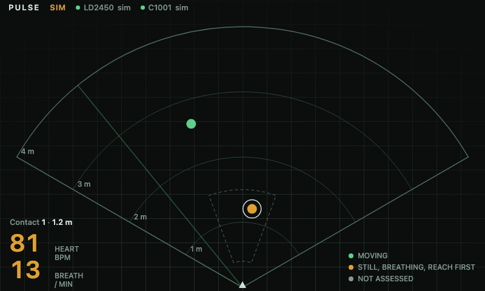
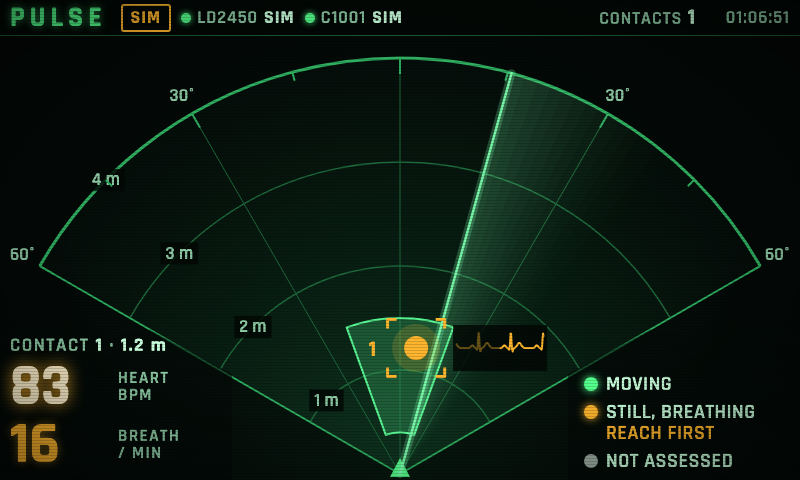
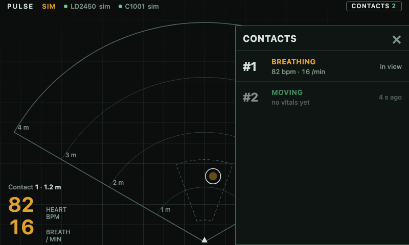
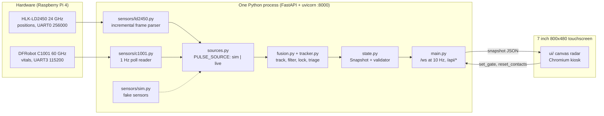
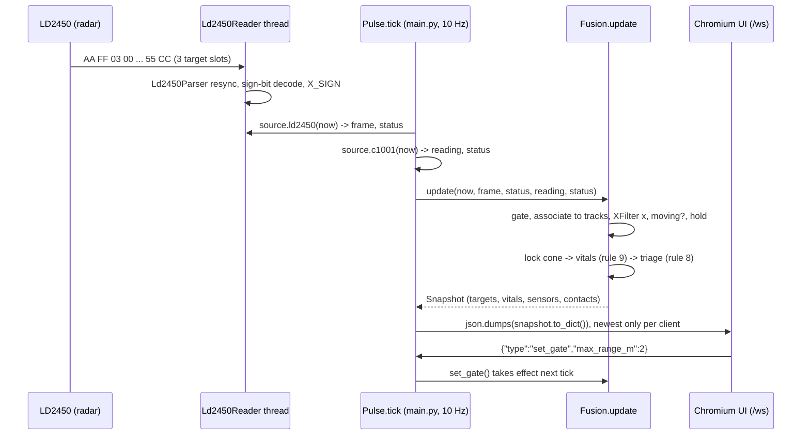

# Pulse

**A handheld radar that finds people through thin walls and reads their breathing and heart rate from arm's length, built for rescuers searching homes after a hurricane.**

Hackathon project (Knight Hacks IX, UCF, October 2026), built by a team of four in 48 hours. It is a working prototype on real hardware, not a certified or medical device. Inspired by the "Pulse" heartbeat sensor from Rainbow Six Siege, except this one is real.

[](https://www.python.org/)
[](https://fastapi.tiangolo.com/)
[](https://developer.mozilla.org/docs/Web/JavaScript)
[](https://www.raspberrypi.com/)
[](docs/hardware.md)
[](pi/tests)

<p align="center">
  
</p>

## Overview

**Run it:** no hardware needed, `PULSE_SOURCE=sim` runs the same fusion code as the device (see [Run it](#run-it)).

After a hurricane, rescuers go house to house through damaged homes, and finding someone who is trapped or too weak to call out still mostly comes down to shouting and listening. The hard part is that no single cheap sensor can do the whole job: the radar that gives positions cannot see vitals, the radar that sees vitals gives no position, and the position radar is built for moving people and loses the still ones who matter most. Pulse fuses two low-cost mmWave radars on a Raspberry Pi into one touchscreen that shows where people are and whether the one in front of you is breathing.

| Role | What they do |
| ---- | ------------ |
| Rescuer (operator) | Holds the unit, watches the radar for dots, walks toward one and aims. Once a dot is in the lock zone (0.4 to 1.5 m, 20 degrees) its breathing and heart rate fill in. Taps a dot for a card, opens the contacts drawer, picks a range (2, 4 or 6 m), holds the wordmark to clear contacts. |
| Developer / demo operator | Runs sim mode on a laptop, watches the raw snapshot on `/debug`, deploys to the Pi with one command, reads logs with `scripts/pi_logs.sh`. |

**Core mechanic:** the LD2450 is the scout (where are people, up to 3 at once) and the C1001 is the medic (is this one breathing). `pi/pulse/fusion.py` tracks the LD2450 detections, picks the one target closest to straight ahead inside the lock cone, and attaches the C1001's vitals to that target only. Triage colors come from movement plus breathing: green is moving, amber is still but breathing, gray is not assessed.

<p align="center">
  
  
</p>

## System Design





## Technical Architecture

- **One fusion path for sim and live**: `pi/pulse/sources.py` defines a `Source` protocol (`ld2450(now)`, `c1001(now)`) and `PULSE_SOURCE` swaps `SimSource` for `LiveSource`. Everything downstream is identical, so the demo path can always run without hardware and the sim scenarios (`demo`, `random`, `cross`, `edge`, `still`) double as regression fixtures.
- **Time is a parameter**: `Fusion.update(now, ...)` never reads the clock, so `pi/tests/test_scenarios.py` replays 120 s of fake time at 10 Hz across 5 seeds in milliseconds and asserts no id swaps, no ghost contacts and no dot past the gate.
- **Parsers are pure and incremental**: `Ld2450Parser` and the C1001 frame parser take arbitrary byte chunks, resync on the header, check the tail and checksum, and count good, bad and skipped bytes. The thin serial reader on top is the only part that needs a port, so both protocols are tested with byte vectors (including the datasheet's example frame) and a fake serial port.
- **Fusion rules, not heuristics scattered around**: ten numbered rules live in `docs/data-contract.md` and are implemented in `pi/pulse/fusion.py` with every constant named and justified at the top. Association tries all one-to-one matchings (at most 3 x 3) and takes the most pairs, then the least distance, and never pairs beyond `ASSOCIATE_M`, so ids do not swap when two people cross.
- **Still people are held, not dropped**: the LD2450 loses stationary targets, so a track survives `HOLD_S` and is kept alive for as long as the C1001 reports presence in the lock cone (`PRESENCE_GRACE_S`). A held dot is drawn as a fading hollow ring so the screen is honest that it is not a fresh detection.
- **Noisy axis gets its own filter**: left/right on the LD2450 comes from a 2-antenna phase angle and is much noisier than range. `pi/pulse/tracker.py` runs an outlier gate, median of 5, EMA and 80 mm deadband on x only, clips velocity residuals, and confirms a track after 3 detections. Association still runs on raw detections so a lagging display never costs a match. `PULSE_XFILTER=0` is the kill switch.
- **A contract with a validator**: `docs/data-contract.md` is the source of truth for the `/ws` message. `pi/pulse/state.py` implements it with a snapshot validator, `ui/contract.js` mirrors the enums, and `pi/tests/test_contract.py` fails if the JS and Python drift. Every snapshot the scenario tests produce passes `validate_snapshot`.
- **Never fake vitals**: breathing and heart rate are only attached to the locked target and only inside the accepted ranges (breath 10 to 25, heart 45 to 150). No reading is `null` and the UI says "settling". The reader also drops breath and heart whenever presence is 0, because the C1001 kept answering frozen values after it stopped measuring.
- **Sensor code never takes the server down**: readers report `ok`, `warming`, `stale` or `offline`, retry every 2 s, and `Pulse.run` catches and logs any tick failure. A slow websocket client gets only the newest snapshot (`Queue(maxsize=1)`), never a backlog.
- **Offline by design**: the UI is plain HTML, CSS and JS with no CDNs and no build step, and `pi/tests/test_server.py` checks the served files contain no external URLs. The unit works in a dead zone.

## Tech Stack

| Layer | Technology | Notes |
| ----- | ---------- | ----- |
| Server | [FastAPI](https://fastapi.tiangolo.com/) + [uvicorn](https://www.uvicorn.org/) | Serves `ui/`, the `/ws` snapshot stream at 10 Hz, `/api/snapshot`, `/api/kiosk`. |
| Language | [Python 3.11+](https://www.python.org/) | Type hints and dataclasses throughout, no runtime deps beyond three packages. |
| Serial | [pyserial](https://pyserial.readthedocs.io/) | LD2450 on UART0 at 256000 baud (PL011, `dtoverlay=disable-bt`), C1001 on UART3 at 115200. |
| UI | Vanilla HTML / CSS / JS, one canvas | Radar, sonar ring, contact card, drawer, range buttons. Designed for exactly 800x480, readable from about 1 m. |
| Display | Chromium kiosk on labwc (Wayland) | Launched by `scripts/kiosk.sh`, relaunches itself, reloaded by `scripts/deploy.sh`. |
| Hardware | [Raspberry Pi 4](https://www.raspberrypi.com/), HLK-LD2450, DFRobot C1001, 7" DSI touchscreen | Powered from a 5 V 3 A power bank. Wiring in [docs/hardware.md](docs/hardware.md). |
| Testing | [pytest](https://docs.pytest.org/), [httpx](https://www.python-httpx.org/), [Playwright](https://playwright.dev/python/) | 203 tests run without hardware; Playwright drives the real UI for the screenshots in `docs/screenshots/`. |
| Ops | systemd user unit, rsync, bash | `scripts/setup_pi.sh` once, `scripts/deploy.sh` per change, no sudo at deploy time. |

## Core Features

### Radar screen (operator)

- **Live radar**: one dot per person out to 6 m across a 120 degree wedge, with 1 m rings and a pulsing sonar ring that sets dot brightness. Held dots fade to hollow rings.
- **Lock and vitals**: a target inside the 0.4 to 1.5 m, 20 degree lock cone shows heart and breath rate, with `settling...` until both are real for 3 s.
- **Contact card**: tap a dot for range, bearing, moving or still, time since first seen, and aiming guidance ("Get within 1.5 m and aim at them", live `Turn N deg`). Shows SIGNAL LOST if the track disappears.
- **Contacts drawer**: server-side history of the last 20 contacts, newest first, with the last breath and heart values seen.
- **Range gate**: range buttons send `set_gate`; the wedge and valid targets follow immediately.
- **Status line**: source (`sim` / `live` / `replay`), per-sensor health dots, and a `NO SIGNAL` state when the socket drops (reconnect backoff 0.5 to 5 s).
- **Kiosk controls**: hold EXIT 1.5 s to close the kiosk, hold the wordmark 1.5 s to clear contacts.

### Server (`pi/pulse/main.py`)

- `GET /ws`: pushes the snapshot at 10 Hz; accepts `{"type":"set_gate","max_range_m":..,"max_angle_deg":..}` and `{"type":"reset_contacts"}`, ignores anything else.
- `GET /api/snapshot`: the latest snapshot as JSON.
- `GET /debug`: raw snapshot, message rate and gate buttons for bring-up.
- `GET /api/kiosk` and `POST /api/kiosk/exit`: kiosk state and close, the latter only from loopback.

### Bring-up and field tools (`tools/`)

- `ld2450_dump.py` and `c1001_dump.py`: live tables of what each sensor says, frames per second, bad frames, with `--record` to `.jsonl`.
- `c1001_probe.py` and `c1001_timeline.py`: run experiments against the C1001 and decode recordings.
- `uart_loopback.py`: five-pattern UART loopback test that tells "nothing came back" from "baud or mini UART".
- `plot_x.py`: plots raw versus shown x from a `LOG_RAW=1` capture, used to tune `tracker.py`.
- `ui_screenshots.py` and `ui_t4_shots.py`: drive the real UI with Playwright and fail on any page error or failed DOM check.

### Planned / deferred

- **Replay mode** (`PULSE_SOURCE=replay`): the source is wired but is a stub that reports both sensors offline. A 30 s seated C1001 recording is committed at `recordings/sample_c1001.jsonl` for it.
- **Command dashboard** (`/command`): the route exists and returns 404 until `ui/command.html` is built.
- **AI sitrep**: `.env.example` reserves `GEMINI_API_KEY` and `ELEVENLABS_API_KEY`; nothing uses them yet.
- **Operator-shield test**: confirm the C1001 does not read the holder's own chest at about 0.4 m (open item in [docs/STATUS.md](docs/STATUS.md)).

## Project Structure

```
pulse/
├── pi/
│   ├── pulse/
│   │   ├── main.py          # FastAPI app, 10 Hz tick, /ws fan-out, kiosk endpoints
│   │   ├── fusion.py        # tracks, association, gate, hold, lock, vitals, triage, contacts
│   │   ├── tracker.py       # x filter: outlier gate, median, EMA, deadband (all knobs at top)
│   │   ├── state.py         # Snapshot dataclasses and contract validator
│   │   ├── sources.py       # Source protocol: sim, live, replay stub
│   │   ├── rawlog.py        # LOG_RAW csv of raw vs shown x
│   │   ├── kiosk.py         # kiosk pidfile / exit handshake
│   │   └── sensors/         # ld2450.py, c1001.py (parsers + readers), sim.py (5 scenarios)
│   ├── tests/               # 203 pytest tests, no hardware needed
│   └── requirements*.txt
├── ui/                      # plain HTML/CSS/JS: radar.js, card.js, drawer.js, controls.js, contract.js
├── tools/                   # sensor dumps, UART loopback, x-filter plot, screenshot drivers
├── scripts/                 # setup_pi.sh, deploy.sh, kiosk.sh, pulse.service, pi_logs.sh
├── docs/                    # data-contract.md, hardware.md, demo.md, PLAYBOOK.md, STATUS.md, screenshots/
├── recordings/              # captured sensor sessions (.jsonl), mostly gitignored
└── .env.example             # PULSE_SOURCE, ports, x filter, raw log switch
```

## Security

This is a local, single-device system, so the relevant boundaries are the network port, the Pi's own configuration and the integrity of what the screen claims.

| Mechanism | Where |
| --------- | ----- |
| Only the Pi's own screen can close the kiosk | `POST /api/kiosk/exit` returns 403 unless the client is `127.0.0.1` or `::1` (`pi/pulse/main.py`, tested in `test_kiosk.py`) |
| Client messages are untrusted | `Pulse.handle_message` ignores non-JSON and unknown types; `Fusion.set_gate` rejects values outside `GATE_RANGE_LIMITS` and `GATE_ANGLE_LIMITS` |
| No runtime network dependency | UI has no CDNs or external URLs, checked in `pi/tests/test_server.py`; works offline |
| Secrets stay out of the repo | API keys come from env vars, `.env` is gitignored, `.env.example` ships blank keys |
| No privileged deploy path | `pulse.service` is a systemd user unit with linger; `scripts/deploy.sh` and `scripts/pi_logs.sh` never use sudo |
| System config changes are contained | Boot and UART changes happen only in `scripts/setup_pi.sh`, which backs up `config.txt`, is idempotent and never reboots |
| Output integrity | `validate_snapshot` in `pi/pulse/state.py`; vitals are `null` unless measured, never synthesized in live mode |
| Hardware safety | Sensor TX pins are measured at 3.3 V before connecting to the Pi's 3.3 V-only GPIO, and the Pi is powered off to change wiring ([docs/hardware.md](docs/hardware.md)) |

## Project Status

| Area | Status |
| ---- | ------ |
| LD2450 parser and reader, C1001 parser and reader | Complete, both verified on real hardware |
| Fusion (tracking, gate hysteresis, still-survivor hold, lock, triage) | Complete, tested in sim and walked live |
| X-axis jitter filter | Complete, deployed on the Pi (on for live, off for sim) |
| Touchscreen UI, kiosk, deploy scripts | Complete, 61 fps on the Pi 4, touch checked on the real 7" panel |
| Sim mode and scenario tests | Complete |
| Power bank runtime and thermal soak | Not measured |
| Phone or watch heart rate cross-check, cardboard test | Not done |
| Replay mode, command dashboard, AI sitrep | Planned |

### Measured and known limits

- **Walk-up lock**: about 10 s from aiming at a chest to real vitals (10.2 s and 10.8 s in two runs). The C1001 shipped in a reporting mode that only computes vitals when its "in bed" state is set, which walking up never does; the reader now writes reporting mode 0 on init. Before the fix it never locked in 125 s.
- **X jitter**: in a simulated fault model (15 cm x noise, 25 percent dropped frames, 8 percent far returns, 40 runs at 0.4 m/s), wrong-way steps went from 133 to 0 and runs with a phantom or new id from 33 to 4. The cost is about 0.3 m of x lag at 0.4 m/s.
- **Materials**: sees through thin materials (drywall, wood, foam, cardboard), not concrete or rubble. A field unit would need a lower-frequency radar.
- **Not medical**: the C1001 is rated for heart rate from 60 to 100 bpm; triage uses movement and breathing and never heart rate thresholds, and the UI avoids diagnostic wording.
- **Range**: vitals need the chest facing the sensor within about 1.5 m and a few seconds to settle.

## Run it

No hardware needed. Sim mode fakes both sensors and runs the same fusion code as the device.

```bash
python3 -m venv .venv && source .venv/bin/activate
pip install -r pi/requirements-dev.txt
cd pi && PULSE_SOURCE=sim SIM_SCENARIO=demo python -m pulse.main
```

Open http://localhost:8000 (built for 800x480). Other scenarios: `random`, `cross` (two people crossing), `edge` (someone at the range limit), `still` (a person the radar keeps losing). Tests:

```bash
cd pi && pytest -q
```

To build the device, see the parts list and wiring in [docs/hardware.md](docs/hardware.md), then:

```bash
ssh -t pulse@pulse.local bash pulse/scripts/setup_pi.sh    # once: UARTs, service, kiosk
PI_HOST=pulse@pulse.local scripts/deploy.sh                # ship code, restart, reload the screen
```

Set `PULSE_SOURCE=live`, `LD2450_PORT` and `C1001_PORT` in `~/pulse/.env` on the Pi (see [.env.example](.env.example)). A sensor that is not connected shows as offline and the app keeps running.

## Credits

Built by Ari Shah, Ananya Varde, Dominic Scarpitta and Alex Weninski at Knight Hacks IX.

The C1001 serial protocol was ported from DFRobot's [DFRobot_HumanDetection](https://github.com/DFRobot/DFRobot_HumanDetection) library (every command is linked to its source line in [docs/hardware.md](docs/hardware.md)). Concept inspired by the Pulse heartbeat sensor in Rainbow Six Siege and by NASA JPL's FINDER search radar.
