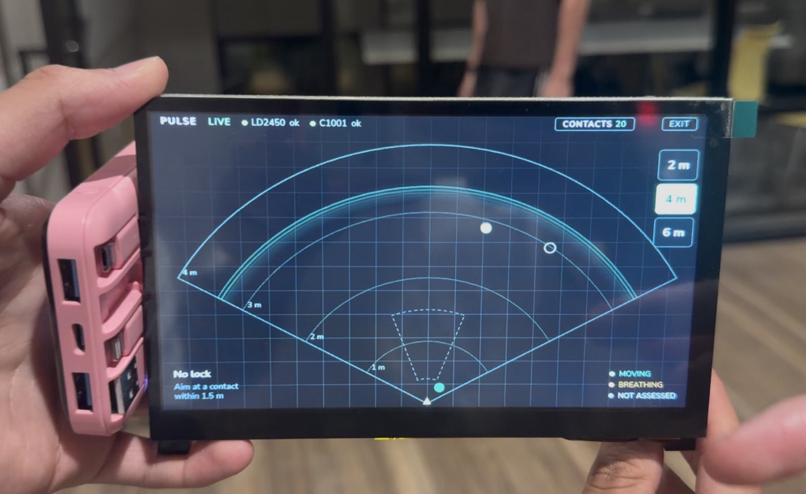
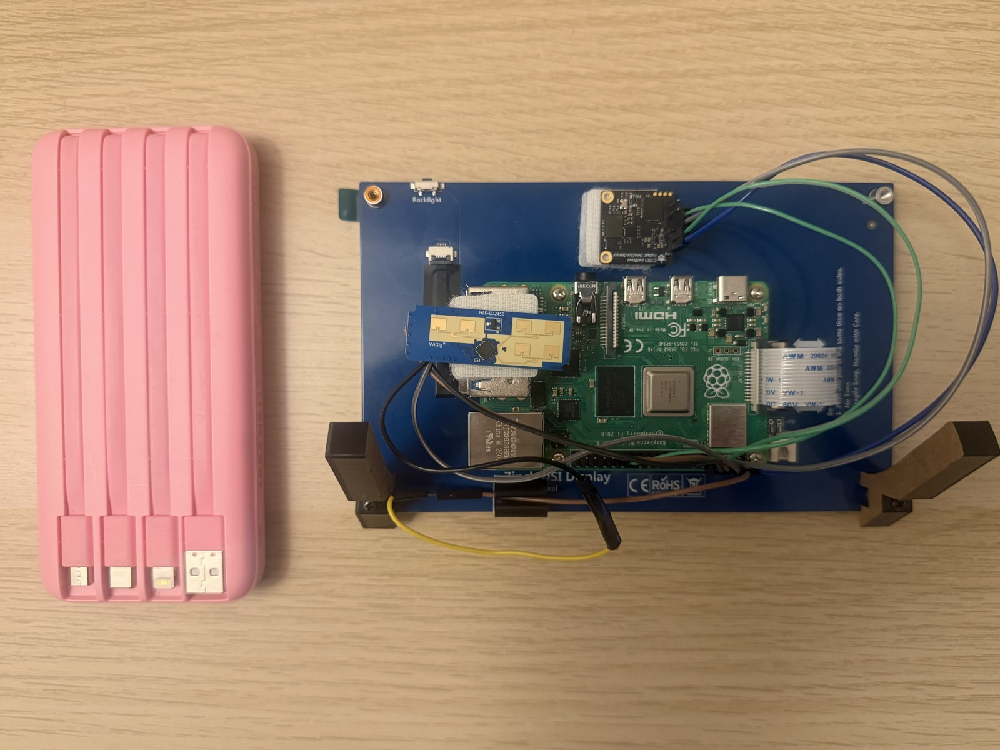
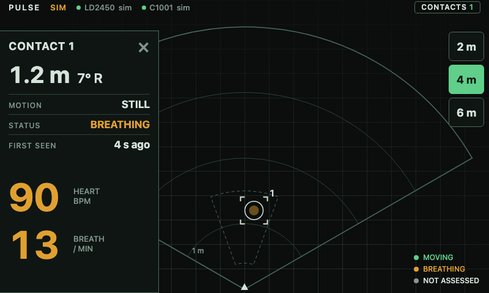
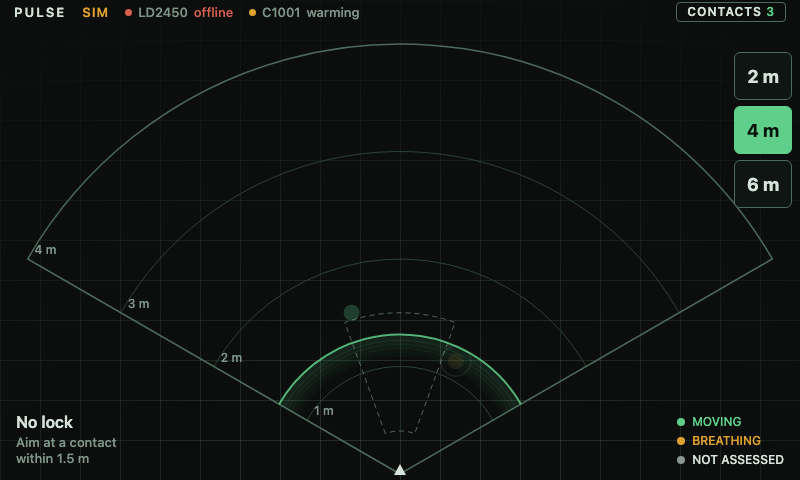
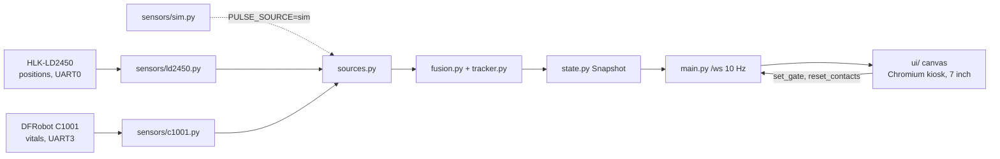
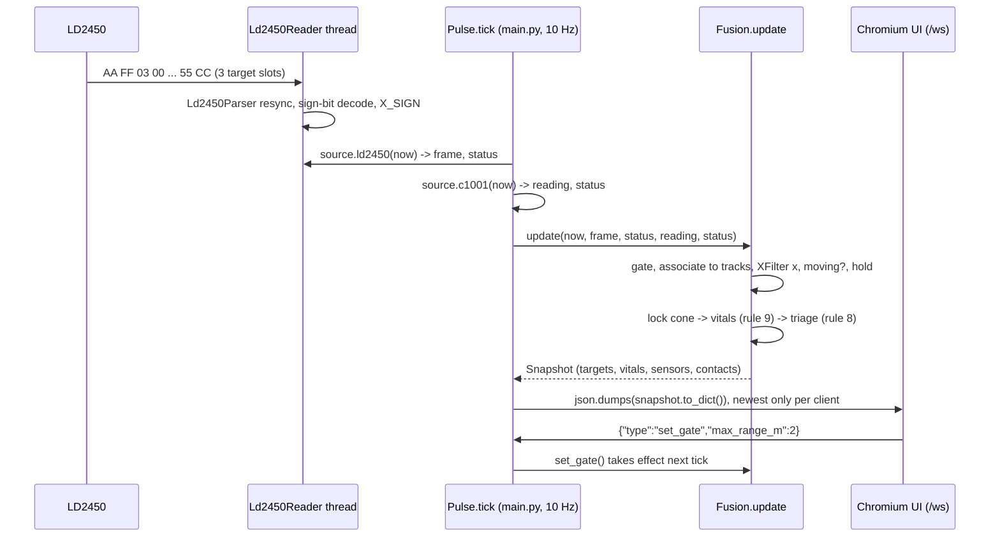

<div align="center">

# Pulse

**A handheld radar that finds people through thin walls and reads their breathing and heart rate from arm's length, built for rescuers searching homes after a hurricane.**


</div>



**Tech:** Python 3.11 · FastAPI · WebSockets · pyserial · Vanilla JS (canvas) · Raspberry Pi 4 · HLK-LD2450 (24 GHz) · DFRobot C1001 (60 GHz) · Chromium kiosk · pytest · Playwright

---

## Overview

After a hurricane, rescuers go house to house through damaged homes, and finding someone who is trapped or too weak to call out still mostly comes down to shouting and listening. Search radars exist (NASA JPL's FINDER helped find four men under rubble after the 2015 Nepal earthquake), but they are big, expensive and rare. The hard part with cheap sensors is that none of them can do the whole job: the radar that gives positions cannot see vitals, the radar that sees vitals gives no position, and the position radar is built for moving people, so it loses the still ones who matter most.

Pulse fuses two low-cost mmWave radars on a Raspberry Pi into one 7" touchscreen that shows where people are and whether the one in front of you is breathing. It was built by a team of four in 48 hours at Knight Hacks IX (UCF), inspired by the "Pulse" heartbeat sensor from Rainbow Six Siege, except this one is real. It is a prototype on real hardware, not a certified or medical device.

## Features

**Find.** The radar screen shows one dot per person, up to 3 at once, out to 6 m across a 120 degree wedge, through drywall, wood, foam or cardboard.

**Lock on.** Walk toward a dot and aim. Once it sits in the lock zone (0.4 to 1.5 m, 20 degrees), its breathing and heart rate fill in, and until they are real the screen says "settling". It never invents a number.

**Triage at a glance.** Green is moving. Amber is still but breathing, the person to reach first. Gray is not assessed yet. Triage uses movement and breathing, never heart rate thresholds.

**Still people stay on the screen.** The position radar drops stationary targets. Pulse keeps a still survivor alive while the vitals radar still senses presence in the lock zone, and draws it as a fading hollow ring so the screen is honest that it is not a fresh detection.

**Built for the field.** One self-contained unit with no cloud and no network: the UI is served by the Pi itself and shown full screen in a Chromium kiosk. A sensor that is unplugged shows as offline and the app keeps running.

**Develop without hardware.** `PULSE_SOURCE=sim` fakes both sensors and runs the exact same fusion code, so the full UI works on a laptop.

## Tech Stack

| Layer | Technology | Notes |
| ----- | ---------- | ----- |
| Server | [FastAPI](https://fastapi.tiangolo.com/) + [uvicorn](https://www.uvicorn.org/) | One process: serves `ui/`, the `/ws` snapshot stream at 10 Hz, `/api/snapshot`, `/api/kiosk`. |
| Language | [Python 3.11+](https://www.python.org/) | Type hints and dataclasses; only three runtime dependencies. |
| Serial | [pyserial](https://pyserial.readthedocs.io/) | LD2450 on UART0 at 256000 baud (PL011, `dtoverlay=disable-bt`), C1001 on UART3 at 115200. |
| UI | Vanilla HTML / CSS / JS, one canvas | Radar, sonar ring, contact card, drawer, range buttons. Designed for exactly 800x480, readable from about 1 m. |
| Display | Chromium kiosk on labwc (Wayland) | Launched by `scripts/kiosk.sh`, relaunches itself, reloaded by `scripts/deploy.sh`. |
| Hardware | [Raspberry Pi 4](https://www.raspberrypi.com/), HLK-LD2450, DFRobot C1001, 7" DSI touchscreen | 5 V 3 A power bank. Parts and wiring in [docs/hardware.md](docs/hardware.md). |
| Testing | [pytest](https://docs.pytest.org/), [httpx](https://www.python-httpx.org/), [Playwright](https://playwright.dev/python/) | 203 tests run without hardware; Playwright drives the real UI for the screenshots. |
| Ops | systemd user unit, rsync, bash | `scripts/setup_pi.sh` once, `scripts/deploy.sh` per change, no sudo at deploy time. |

## The Hardware

The two radars are velcroed to the back of the screen with the Pi 4 behind it. The LD2450 (scout) and C1001 (medic) are the only sensors; everything else is software.



| | Job | Sensor |
| --- | --- | --- |
| **The scout** | Where are people? Up to 3 at once, about 6 m out, 120 degree field of view | HLK-LD2450, 24 GHz |
| **The medic** | Is this one breathing? Breathing and heart rate, no contact, 0.4 to 1.5 m | DFRobot C1001, 60 GHz |

## Screenshots

The images below are from sim mode, which runs the same fusion code as the device.

**Contact card:** range, bearing, motion, status and vitals for the locked contact


**Contacts drawer:** server-side history of the last 20 contacts, newest first


**Walker and sitter:** a moving contact further out while a still one is locked


**Sensors down:** LD2450 offline and C1001 warming (mocked states), and the app keeps running and says so


## Architecture



## Engineering Decisions

**Two radars that disagree, fused by a lock cone.** The LD2450 gives positions but no vitals and the C1001 gives vitals but no position, and the C1001 cannot say who it is looking at. Fusion in `pi/pulse/fusion.py` only ever attaches the C1001's numbers to the single tracked target inside the lock cone (0.4 to 1.5 m, 20 degrees, closest to straight ahead). Aiming the device is how the operator chooses who is measured, which makes a hardware limitation into the interaction.

**Still people vanish, so tracks are held.** The LD2450 is built for moving targets, and a person who is unconscious or trapped is exactly the one it drops. A track survives `HOLD_S` after its last detection and is kept alive for as long as the C1001 reports presence in the lock cone (`PRESENCE_GRACE_S`). The `still` sim scenario reproduces the dropouts and `tests/test_scenarios.py` asserts the sitter never leaves the screen and still shows amber while the LD2450 has lost them.

**Noisy left/right, fixed with a display filter.** The LD2450's left/right comes from a 2-antenna phase angle and is much noisier than range. A far return could send a dot the wrong way and make the track lose its person. `pi/pulse/tracker.py` adds an outlier gate, median of 5, EMA and an 80 mm deadband on x only, clips velocity residuals and confirms a track after 3 detections. Association still runs on raw detections so a lagging display never costs a match. Against a simulated fault model (15 cm x noise, 25 percent dropped frames, 8 percent far returns, 40 runs at 0.4 m/s), wrong-way steps went from 133 to 0 and runs with a phantom or new id from 33 to 4, at a cost of about 0.3 m of x lag. `PULSE_XFILTER=0` is the kill switch.

**Walk-up vitals never locked, until we found the reporting mode.** On the real C1001, walking up to a seated person never produced breathing or heart rate (125 s with no lock). The sensor shipped in reporting mode 1, which only computes vitals while its "in bed" state is set, and walking up never sets it. `C1001Reader` now writes reporting mode 0 during init, and lock takes about 10 s (10.2 s and 10.8 s in two runs). The same investigation found mode 1 kept answering frozen values after it stopped measuring, so readings with presence 0 never carry breath or heart.

**Sim and live share one path.** `pi/pulse/sources.py` defines a `Source` protocol and `PULSE_SOURCE` swaps the sim for the real readers. Everything downstream is identical, so the demo path can always run without hardware and the sim scenarios (`demo`, `random`, `cross`, `edge`, `still`) double as regression fixtures.

## Results

- Both sensors live on a Raspberry Pi 4 with a 7" touchscreen: live dots and live vitals on the screen, locking about 10 s after aiming at a seated person
- UI holds 61 fps on the Pi 4, and touch was checked on the real panel (all four corners, drawer scrolling, dot taps)
- 203 tests pass without hardware, including 120 s x 5 seed scenario runs where every snapshot passes the contract validator
- Both serial protocols (24 GHz binary frames with a sign bit, 60 GHz poll and reply) were written from datasheets and tested with byte vectors before the sensors arrived, then verified on real hardware

## What's Next

- **Replay mode:** `PULSE_SOURCE=replay` is wired but is a stub. A 30 s seated C1001 recording is committed at `recordings/sample_c1001.jsonl` for it.
- **Operator shield test:** confirm the C1001 does not read the holder's own chest at about 0.4 m, and if it does, shield it and cross-check C1001 distance against the locked dot's range.
- **Command dashboard (`/command`) and AI sitrep:** the route exists and returns 404 until `ui/command.html` is built; `.env.example` reserves the API key names.
- **More field testing:** power bank runtime and thermals, a phone or watch heart rate cross-check, and cardboard in front of the sensor.
- **Lower-frequency radar:** Pulse sees through thin materials, not concrete or rubble. A real field unit would need it.

<details>
<summary><b>Technical deep dive</b></summary>

**Core mechanic:** the LD2450 is the scout and the C1001 is the medic. `Pulse.tick` in `main.py` pulls the latest frame and reading from the source every 100 ms, `Fusion.update` turns them into a validated `Snapshot`, and every websocket client gets the newest one.

### Frame to screen sequence



### Architecture notes

- **Time is a parameter.** `Fusion.update(now, ...)` never reads the clock, so `tests/test_scenarios.py` replays 120 s of fake time at 10 Hz across 5 seeds in milliseconds and asserts no id swaps, no ghost contacts and no dot past the gate.
- **Parsers are pure and incremental.** `Ld2450Parser` and the C1001 frame parser take arbitrary chunks, resync on the header, check the tail and checksum, and count good, bad and skipped bytes. The thin serial reader on top is the only part that needs a port, so both protocols are tested with byte vectors (including the datasheet's example frame) and a fake serial port.
- **The LD2450 uses a sign bit, not two's complement.** Top bit set means positive, magnitude is the low 15 bits. Which way is left and which way is approaching is decided by `X_SIGN` and `SPEED_SIGN` in `sensors/ld2450.py`, nowhere else.
- **The C1001 is polled, not pushed.** Ported from DFRobot's `DFRobot_HumanDetection` library (frame length is big-endian, command words linked line by line in `docs/hardware.md`). The reader polls presence, movement, breath and heart once a second, retries every 2 s and reports `ok`, `warming`, `stale` or `offline`.
- **Association is exhaustive.** With at most 3 tracks and 3 detections, `_associate` tries every one-to-one matching and takes the most pairs, then the least distance to the predicted positions, and never pairs beyond `ASSOCIATE_M` (0.6 m). Ids do not swap when two people cross, which a greedy nearest-neighbor did.
- **Gate hysteresis.** New tracks start only inside the gate and live to gate + 0.3 m / 5 degrees. In the margin a track keeps its id and contact but is not shown and cannot lock, so a person hovering at the range limit does not spawn a new contact every cycle.
- **A contract with a validator.** `docs/data-contract.md` is the source of truth for `/ws` and the ten fusion rules. `pi/pulse/state.py` implements it with `validate_snapshot`, `ui/contract.js` mirrors the enums, and `tests/test_contract.py` fails if the JS and Python drift.
- **Sensor code never takes the server down.** `Pulse.run` catches and logs any tick failure and keeps its cadence, a reader error marks that sensor `offline`, and a slow websocket client gets only the newest snapshot (`Queue(maxsize=1)`), never a backlog.
- **Offline by design.** No CDNs and no build step, and `tests/test_server.py` checks the served files contain no external URLs.

### Route map

| Area | Routes |
| ---- | ------ |
| UI | `/` (radar), `/debug` (raw snapshot, message rate, gate buttons) |
| Stream | `WS /ws` at 10 Hz; client messages `set_gate`, `reset_contacts` |
| REST | `GET /api/snapshot`, `GET /api/kiosk`, `POST /api/kiosk/exit` (loopback only) |
| Planned | `/command` (404 until `ui/command.html` exists) |

### Bring-up and field tools

| Tool | Purpose |
| ---- | ------- |
| `tools/ld2450_dump.py`, `tools/c1001_dump.py` | Live tables of what each sensor says, frames per second, bad frames, `--record` to `.jsonl` |
| `tools/c1001_probe.py`, `tools/c1001_timeline.py` | Experiment against the C1001 and decode recordings |
| `tools/uart_loopback.py` | Five-pattern UART loopback that tells "nothing came back" from "baud or mini UART" |
| `tools/plot_x.py` | Plot raw versus shown x from a `LOG_RAW=1` capture, used to tune `tracker.py` |
| `tools/ui_screenshots.py`, `tools/ui_t4_shots.py` | Drive the real UI with Playwright, fail on any page error or failed DOM check |

### Project structure

```text
pulse/
├── pi/
│   ├── pulse/
│   │   ├── main.py          # FastAPI app, 10 Hz tick, /ws fan-out, kiosk endpoints
│   │   ├── fusion.py        # tracks, association, gate, hold, lock, vitals, triage, contacts
│   │   ├── tracker.py       # x filter: outlier gate, median, EMA, deadband (all knobs at top)
│   │   ├── state.py         # Snapshot dataclasses and contract validator
│   │   ├── sources.py       # Source protocol: sim, live, replay stub
│   │   ├── rawlog.py        # LOG_RAW csv of raw vs shown x
│   │   ├── kiosk.py         # kiosk pidfile / exit handshake
│   │   └── sensors/         # ld2450.py, c1001.py (parsers + readers), sim.py (5 scenarios)
│   ├── tests/               # 203 pytest tests, no hardware needed
│   └── requirements*.txt
├── ui/                      # plain HTML/CSS/JS: radar.js, card.js, drawer.js, controls.js, contract.js
├── tools/                   # sensor dumps, UART loopback, x-filter plot, screenshot drivers
├── scripts/                 # setup_pi.sh, deploy.sh, kiosk.sh, pulse.service, pi_logs.sh
├── docs/                    # data-contract.md, hardware.md, demo.md, PLAYBOOK.md, STATUS.md, photos/, screenshots/
├── recordings/              # captured sensor sessions (.jsonl), mostly gitignored
└── .env.example             # PULSE_SOURCE, ports, x filter, raw log switch
```

### Security and safety

| Mechanism | Where |
| --------- | ----- |
| Only the Pi's own screen can close the kiosk | `POST /api/kiosk/exit` returns 403 unless the client is `127.0.0.1` or `::1` (`main.py`, tested in `test_kiosk.py`) |
| Client messages are untrusted | `Pulse.handle_message` ignores non-JSON and unknown types; `Fusion.set_gate` rejects values outside `GATE_RANGE_LIMITS` and `GATE_ANGLE_LIMITS` |
| No runtime network dependency | UI has no CDNs or external URLs, checked in `tests/test_server.py` |
| Secrets stay out of the repo | API keys come from env vars, `.env` is gitignored, `.env.example` ships blank keys |
| No privileged deploy path | `pulse.service` is a systemd user unit with linger; `deploy.sh` and `pi_logs.sh` never use sudo |
| System config changes are contained | Boot and UART changes happen only in `scripts/setup_pi.sh`, which backs up what it edits, is idempotent and never reboots |
| Output integrity | `validate_snapshot` in `state.py`; vitals are `null` unless measured, never synthesized in live mode |
| Hardware safety | Sensor TX pins are measured at 3.3 V before connecting to the Pi's 3.3 V-only GPIO, and the Pi is powered off to change wiring |
| Honest claims | No medical or diagnostic wording in the UI; heart rate is rated 60 to 100 bpm and never used for triage |

</details>

<details>
<summary><b>Run it</b></summary>

### Without hardware (sim mode)

Sim mode fakes both sensors and runs the same fusion code as the device.

```bash
python3 -m venv .venv && source .venv/bin/activate
pip install -r pi/requirements-dev.txt
cd pi && PULSE_SOURCE=sim SIM_SCENARIO=demo python -m pulse.main
```

Open http://localhost:8000 (built for 800x480). Other scenarios: `random`, `cross` (two people crossing), `edge` (someone at the range limit), `still` (a person the radar keeps losing).

### Tests

```bash
cd pi && pytest -q
```

### On the device

Parts and wiring are in [docs/hardware.md](docs/hardware.md). Then:

```bash
ssh -t pulse@pulse.local bash pulse/scripts/setup_pi.sh    # once: UARTs, service, kiosk
PI_HOST=pulse@pulse.local scripts/deploy.sh                # ship code, restart, reload the screen
```

Set `PULSE_SOURCE=live`, `LD2450_PORT` and `C1001_PORT` in `~/pulse/.env` on the Pi (see [.env.example](.env.example)).

### Env var names

- `PULSE_SOURCE` (`sim`, `live`, `replay`)
- `SIM_SCENARIO` and `SIM_SEED` (sim only)
- `LD2450_PORT` (default `/dev/ttyAMA0`) and `C1001_PORT` (`/dev/ttyAMA3`)
- `PULSE_XFILTER` (`1` / `0`, blank is on for live and off for sim)
- `LOG_RAW` (`1` writes `recordings/xlog_<time>.csv`)

### Useful commands

| Command | What it does |
| ------- | ------------ |
| `cd pi && pytest -q` | Run the 203 tests |
| `scripts/deploy.sh` | rsync to the Pi, restart the service, reload the kiosk |
| `scripts/pi_logs.sh` | Follow the service logs on the Pi |
| `python tools/ld2450_dump.py /dev/ttyAMA0 --multi` | Live LD2450 view on the Pi (stop the service first) |
| `python tools/uart_loopback.py /dev/ttyAMA0 256000` | Check a UART with a jumper from TX to RX |

</details>

---

Built at Knight Hacks IX (UCF, October 2026) by Ari Shah, Ananya Varde, Dominic Scarpitta and Alex Weninski.

The C1001 protocol was ported from DFRobot's [DFRobot_HumanDetection](https://github.com/DFRobot/DFRobot_HumanDetection) library, with every command linked to its source line in [docs/hardware.md](docs/hardware.md). Concept inspired by the Pulse heartbeat sensor in Rainbow Six Siege and by NASA JPL's FINDER.

Ari Shah · [Portfolio](https://www.ar13.dev/)
